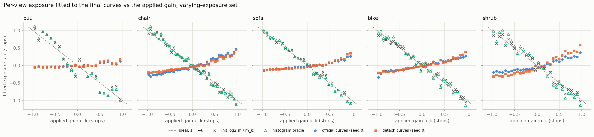
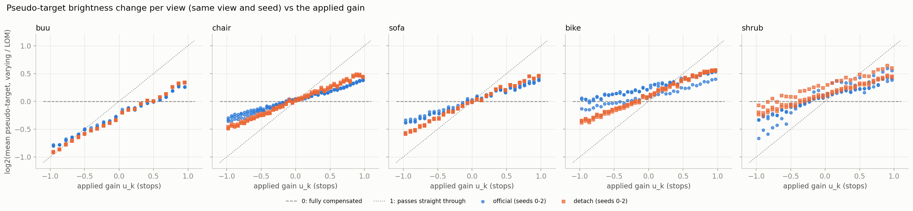
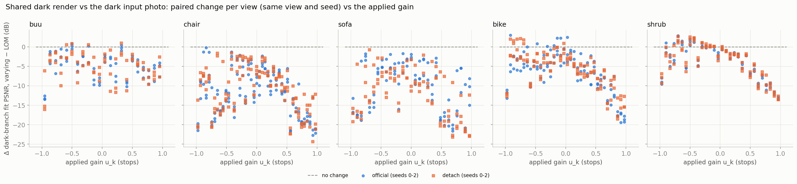

# M1 results: the official code and `detach` on the varying-exposure LOM set

This is a measurement only; no new method is involved. M1 built a second version of LOM in which every training photo is brightened or darkened by a known gain 2^{u_k}:

- **The gains:** u_k is spread evenly over [−1, 1] stops. The draws are stratified, so the mean is exactly 0 (dataset seed 701).
- **Where it lives:** `data/LOM_vexp/`; the u_k are in [`gains.json`](../results/vexp/dataset/gains.json).
- **What is unchanged:** the test views, the normal-light ground truth (`high/`) and the cameras are byte-identical to LOM.

The official code (`baseline`, called "official" below) and the `detach` reference were trained on this set: 5 scenes × 2 variants × seeds 0–2, so 30 runs of 10k steps. Every run was then re-scored with the **LOM** reference depth (`results/rung0/<scene>_baseline_seed0`), so its consistency numbers can be compared directly with Rung 0.5. Each run is paired with the run of the same scene, variant and seed on LOM.

**Where things are:**
- Outputs: [`results/vexp/summary/`](../results/vexp/summary/) ([`tables.md`](../results/vexp/summary/tables.md)), regenerated by `python vexp_analyze.py` in about 4 minutes.
- Plan: [`M1_vexp_plan.md`](M1_vexp_plan.md).

**How to read the claims:**
- *Measured* means read from the runs; *inferred* marks an interpretation.
- An effect is called real when it exceeds 2× noise, where noise is the square root of the mean of the two arms' seed variances (3 seeds each). The ratio to noise is given as (×).
- "bm" means brightness-matched PSNR.
- "Pooled" means the mean over the five scenes, taken per seed.
- Shrub is reported but not used to decide anything (protocol rule 7).

## Short answers

- **Q1. Cost of varying exposure:** both methods lose brightness-matched PSNR. Pooled, official loses 2.68 dB (8.2×) and `detach` 2.22 dB (4.3×). Almost all of the loss is on buu, chair and sofa (2.1 to 5.2 dB).
- **Q2. The H2 bar:** `detach` stays the stronger reference, ahead by +1.72 dB bm PSNR (3.1×) and −0.045 LPIPS (3.5×) pooled. Its lead over official is not detectably larger than on LOM. Rung 2 must beat `detach` on this set (reference table below).
- **Q3. Do the per-view curves compensate exposure? No.** In both methods the per-view part of the curve moves the *wrong* way: it rises with the input's brightness. The pseudo-targets still half-compensate, but only because the shared curve is concave. The same sign holds on LOM, which Rung 0 had not checked.
- **Q4. The shared dark branch:** it suffers badly. Its fit to the dark photos drops by 3.6 to 11.9 dB per scene, on both sides of u = 0 and more steeply for brightened views.

## Answers

**Q1. How much does the 2-stop spread cost each baseline?**

Validation on LOM → on the varying set, mean over seeds. The paired difference is in brackets, and **bold** marks a real effect.

| Scene | Official raw PSNR | Official bm PSNR | `detach` raw PSNR | `detach` bm PSNR |
|---|---|---|---|---|
| buu | 20.81 → 22.01 (+1.20, 2.0×) | 26.00 → 22.33 (**−3.67, 6.5×**) | 21.56 → 22.81 (+1.25, 1.9×) | 26.37 → 24.26 (−2.11, 2.0×) |
| chair | 17.76 → 14.76 (**−2.99, 11.1×**) | 20.94 → 17.82 (**−3.12, 18.5×**) | 18.82 → 15.49 (**−3.34, 3.4×**) | 23.09 → 19.89 (**−3.20, 5.5×**) |
| sofa | 23.22 → 18.77 (**−4.45, 6.1×**) | 25.22 → 20.04 (**−5.19, 10.8×**) | 23.47 → 21.67 (−1.80, 1.0×) | 27.41 → 23.84 (**−3.57, 4.3×**) |
| bike | 18.42 → 15.48 (**−2.94, 4.0×**) | 19.45 → 19.24 (−0.21, 1.5×) | 16.02 → 14.55 (−1.47, 1.7×) | 21.31 → 20.42 (**−0.89, 3.5×**) |
| shrub | 12.13 → 10.74 (−1.40, 1.5×) | 18.37 → 17.13 (−1.24, 1.5×) | 11.76 → 9.83 (**−1.93, 4.0×**) | 18.06 → 16.71 (**−1.35, 3.8×**) |
| pooled | 18.47 → 16.35 (**−2.11, 4.2×**) | 22.00 → 19.31 (**−2.68, 8.2×**) | 18.33 → 16.87 (−1.46, 1.8×) | 23.25 → 21.03 (**−2.22, 4.3×**) |

*Measured:*
- **Brightness-matched PSNR falls in every cell.** The drop is largest on buu, chair and sofa: 3.1 to 5.2 dB for official, 2.1 to 3.6 dB for `detach`. On bike and shrub it is 0.2 to 1.4 dB.
- **SSIM and LPIPS get worse too.** SSIM falls in all 10 cells (real in 8). LPIPS rises in 9 of 10 (real in 6). Pooled, LPIPS rises by +0.057 for official (9.8×) and +0.036 for `detach` (2.5×).
- **Buu's raw PSNR rises (+1.2 dB in both variants, about 2×, not real) while its brightness-matched PSNR falls.** The cause is a brightness shift. Buu's validation renders got darker: official 0.571 → 0.513 mean (−0.058, 7.9×), `detach` 0.561 → 0.520 (4.7×). Both moved closer to the ground-truth mean of 0.491. Raw PSNR rewards that shift, not better images. This is why raw and brightness-matched PSNR are always reported side by side.

*Inferred:*
- Part of this cost is 8-bit quantisation. Halving a view whose mean is 7 to 29 levels merges tonal levels, and no model can recover them (plan section 2). M1 cannot separate that part from the modelling cost.

**Q2. Is `detach` still the stronger reference, and what is the bar for H2?**

Yes: `detach` minus official, on each set, and how the gap changes. All values are paired by seed.

| Scene | bm PSNR, varying | bm PSNR, LOM | Change | LPIPS, varying | LPIPS, LOM | Change |
|---|---|---|---|---|---|---|
| buu | +1.93 (1.6×) | +0.38 (1.3×) | **+1.56 (2.2×)** | −0.009 (0.7×) | **+0.017 (2.2×)** | −0.026 (1.3×) |
| chair | **+2.07 (3.5×)** | **+2.15 (15.4×)** | −0.08 (0.1×) | −0.041 (1.1×) | **−0.027 (5.4×)** | −0.013 (0.3×) |
| sofa | **+3.80 (4.4×)** | **+2.19 (5.1×)** | +1.62 (1.7×) | **−0.076 (3.5×)** | −0.016 (2.0×) | **−0.060 (2.4×)** |
| bike | **+1.19 (4.3×)** | **+1.87 (19.5×)** | **−0.68 (2.7×)** | **−0.074 (6.4×)** | **−0.118 (7.7×)** | **+0.044 (3.8×)** |
| shrub | −0.42 (1.0×) | −0.31 (0.4×) | −0.11 (0.2×) | −0.027 (0.6×) | +0.025 (0.7×) | −0.052 (0.8×) |
| pooled | **+1.72 (3.1×)** | **+1.26 (5.4×)** | +0.46 (0.8×) | **−0.045 (3.5×)** | **−0.024 (2.8×)** | −0.021 (1.8×) |

*Measured:*
- **Where `detach` wins:**
  - bm PSNR on chair, sofa, bike and pooled;
  - LPIPS on sofa, bike and pooled.
- **Official is never detectably better** on these two metrics.
- **Raw PSNR shows no real difference in any scene** on the varying set (pooled +0.52, 0.6×). SSIM differs really only on sofa (+0.031, `detach` better) and shrub (−0.023, `detach` worse).
- **The gap does not grow consistently under varying exposure.**
  - In `detach`'s favour: buu bm PSNR (+1.56), and sofa LPIPS and SSIM.
  - In official's favour: bike bm PSNR (−0.68) and LPIPS (+0.044).
  - Pooled, the change is +0.46 dB (0.8×).

*Inferred:* detaching makes the model somewhat more robust to varying exposure on buu and sofa, but not in general. The varying set does not favour `detach` by itself.

**The H2 bar: reference numbers on the varying set.** Means over seeds 0–2, from tables T1, T6 and T7.
- Pseudo-target consistency is `rel_l1_pseudo` divided by the ground truth's `rel_l1_gt` under the same warp. On LOM, `detach` scores 1.56 / 0.97 / 1.67 / 1.72 / 1.19.

| Scene | `detach`: raw / bm PSNR | SSIM | LPIPS | Angle error (°) | `sat_ratio` | Pseudo-target consistency (× GT) | Official: raw / bm / SSIM / LPIPS |
|---|---|---|---|---|---|---|---|
| buu | 22.81 / 24.26 | 0.881 | 0.251 | 3.64 | 0.94 | 4.73 | 22.01 / 22.33 / 0.877 / 0.261 |
| chair | 15.49 / 19.89 | 0.815 | 0.356 | 7.12 | 0.33 | 5.41 | 14.76 / 17.82 / 0.797 / 0.397 |
| sofa | 21.67 / 23.84 | 0.884 | 0.300 | 2.52 | 0.84 | 8.98 | 18.77 / 20.04 / 0.853 / 0.375 |
| bike | 14.55 / 20.42 | 0.745 | 0.329 | 2.54 | 0.44 | 4.61 | 15.48 / 19.24 / 0.742 / 0.403 |
| shrub | 9.83 / 16.71 | 0.550 | 0.296 | 13.27 | 0.40 | 1.60 | 10.74 / 17.13 / 0.573 / 0.323 |
| pooled | 16.87 / 21.03 | 0.775 | 0.306 | 5.82 | 0.59 | | 16.35 / 19.31 / 0.768 / 0.352 |

**Seed noise is larger on this set** (*measured*, T1).
- Official bm PSNR sd is 0.15 to 0.73 dB.
- `detach` bm PSNR sd is 0.03 to 1.51 dB: buu 1.51, sofa 1.11, chair 0.82. Its raw PSNR sd reaches 2.59 dB on sofa.
- So the smallest detectable effect for H2 must be computed from these runs, not from the LOM table in protocol section "Noise floor".

**Q3. Do the official per-view curves compensate for exposure, and does `detach` behave differently?**

No, and `detach` behaves the same way.

*Measured* (T4a, figure 2):
- **The fitted exposures have the wrong sign.** One shared F and one exposure s_k per view were fitted to each run's final per-view curves (`curve_adj`, weighted by bin usage). The s_k rise with u_k:
  - official: slope +0.07 (buu) to +0.31 (chair);
  - `detach`: slope +0.10 to +0.44;
  - r is +0.80 to +0.98 for both.
- **The references point the right way.** Full compensation would give slope −1. The initialisation log2(m̄/m_k) gives −0.95 to −1.04, and the histogram oracle (the same fit on the HE-CDF targets) gives −1.04 to −1.11.
- **Recovery error is large.** The paired RMSE of s + u_k is 0.61 to 0.84 stops, against 0.004 to 0.019 for the init and 0.038 to 0.082 for the oracle.

*Measured, without the exposure fit:*
- **Curve values at fixed inputs follow the gain.** At any fixed low input level, the curve value correlates +0.94 to +0.97 with u_k (chair, buu and sofa, seed 0).
- **So does the per-view bias, and the bias grows during training.** The bias network's per-view output correlates +0.94 to +0.97 with u_k:
  - in every scene from step 1000 on, both variants, seed 0;
  - also at step 1 in four scenes (shrub: −0.95 at step 1).

  Its spread across views grows from about 0 at step 1 to 0.017 (buu) to 0.16 (shrub `detach`) at step 10k, in curve units of 0 to 1.
- **The fit itself is sound.** It returns slope −1.000 on synthetic curves built to compensate.
- **The same sign holds on LOM.** On the original LOM runs, the per-view bias correlates +0.97 to +1.00 with the view's log2 mean brightness in all 30 runs (official and `detach`).
  - Rung 0 found that cross-view curve variation is "one number that tracks brightness" but reported only |r|.
  - It tracks brightness in the direction that *follows* the input, not the one that compensates it.

*Measured* (T4b, figure 3): how much of each view's exposure change reaches its outputs. The "leak" is the slope of log2(mean brightness, varying / LOM, same view and seed) against u_k: 0 means fully compensated, 1 means it passes straight through.

| | Official | `detach` |
|---|---|---|
| dark input (check) | 1.00 to 1.02 | 1.00 to 1.02 |
| pseudo-targets | 0.27 to 0.56 (pooled 0.41) | 0.36 to 0.65 (pooled 0.51) |
| enhanced render at the training view | 0.06 to 0.45 (pooled 0.19) | 0.13 to 0.54 (pooled 0.22) |

- The curves' cross-view spread (×255) grows from 2.3 (official) and 2.6 (`detach`) on LOM to 6.6 and 7.8 on the varying set (pooled).
- The exposure form explains 0.86 and 0.92 of that spread, but with the wrong sign.

*Inferred:*
- **The half-compensation comes from the curve's shape, not from per-view adaptation.** A concave curve compresses brightness ratios even when it is identical for every view, and the per-view part pushes slightly the other way.
- **The renders leak less than the pseudo-targets** because the Gaussians are shared across views and average them out.
- **Why the bias runs this way is not identified.** It is not tested here.
  - The loss that trains the bias network pulls each curve toward its own HE-CDF, and those targets compensate (oracle slope −1.08).
  - The bias network learns at lr 1e-5, against 1e-3 for the global curve. Its per-view output keeps one direction from early on, and training scales it up rather than turning it round.

**Q4. How much does the shared dark branch suffer?**

*Measured* (T5a): PSNR of the shared dark render against the dark input photo, at the training views, LOM → varying set:

| Scene | Official | `detach` |
|---|---|---|
| buu | 46.2 → 41.2 (−5.0) | 46.3 → 41.2 (−5.1) |
| chair | 49.0 → 37.1 (−11.9) | 49.0 → 38.0 (−11.0) |
| sofa | 47.3 → 37.1 (−10.2) | 47.4 → 35.6 (−11.9) |
| bike | 47.2 → 40.7 (−6.5) | 47.7 → 41.9 (−5.9) |
| shrub | 40.9 → 37.3 (−3.6) | 40.8 → 37.1 (−3.7) |
| pooled | 46.1 → 38.7 (−7.4) | 46.2 → 38.8 (−7.5) |

Every drop is real (4.7× to 43×).

*Measured* per view (T5b, figure 4): the fit gets worse on both sides of u = 0, and more steeply for brightened views. Pooled, official:

| | Mean change | Slope |
|---|---|---|
| darkened views (u < 0) | −6.3 dB | +5.7 dB per stop |
| brightened views (u > 0) | −9.5 dB | −13.4 dB per stop |

For `detach` the slopes are +5.2 and −12.9 dB per stop.

*Inferred:*
- **One dark colour per Gaussian cannot match photos two stops apart.** It settles near the middle exposures (plan section 3.3), and only the view-dependent SH terms can absorb a little of the difference.
- **The steeper loss for brightened views is partly the metric.** Absolute-error PSNR penalises brighter images more.
- **M1 does not measure how much this misfit costs the enhanced render.**

*Measured* (T5a), pseudo-target quality at the training views against their normal-light images, pooled:
- bm pseudo-PSNR: −1.85 dB (official, 9.2×) and −1.18 dB (`detach`, 25×);
- raw pseudo-PSNR: −3.2 and −3.0 dB.

## Other findings

- **Consistency** (*measured*, T6). Pseudo-target relative L1 after the shared-depth warp, pooled:
  - official 0.071 → 0.202, `detach` 0.084 → 0.248, against a ground-truth floor of 0.062;
  - in units of the floor, `detach` goes from 0.97–1.72 on LOM to 1.6–9.0 on the varying set.

  Enhanced renders: 0.032 → 0.072 (official) and 0.036 → 0.089 (`detach`). *Inferred:* this is mostly the brightness leak of Q3, since neighbouring views' pseudo-targets now differ in brightness.
- **Colour** (*measured*, T7).
  - Bike `detach`'s hue error on coloured pixels falls from 31.8° to 12.3° (−19.5°, 12.9×); official's falls from 21.5° to 16.9° (4.3×).
  - Saturation falls really on chair and sofa (both variants) and on bike `detach` (0.497 → 0.442).

  *Inferred:* the hue metric is unreliable on desaturated predictions (Rung 0.5 Q5), and bike `detach` got paler. Do not read the hue drop as a colour fix until the CIELAB chroma error planned for Rung 2 confirms it.
- **Wall time** (*measured*, T7b): official 12.6 → 13.2 min per run, `detach` 7.9 → 8.1 min.

## What this means for Rung 2

1. **The bar.** Rung 2 must beat `detach` on this set, using the reference table above (pooled bm PSNR 21.03, LPIPS 0.306). Compute its detectable effect from this set's seed noise, which reaches 1.51 dB bm on buu. The explainer's LOM-based table understates it.
2. **The mechanism H2 relies on is now concrete** (*inferred*).
   - The official per-view curves leave 27 to 65% of each view's exposure change in its pseudo-target, and their per-view part pushes the wrong way.
   - Rung 2's s_k starts at log2(m̄/m_k), slope −1, and is trained against HE-CDF targets that also have slope −1. Its pseudo-targets should therefore carry almost none of the change.
   - Measure the same leak for Rung 2 (T4b). A pseudo-target leak near 0 confirms the mechanism whether or not PSNR improves.
3. **The exposure criterion needs rewording.**
   - The explainer's |r| ≥ 0.9 with slope near −1 is met by the initialisation alone (r −0.95 to −0.99; paired −1.000).
   - The official curves fail it with the wrong sign.
   - For Rung 2, report slope, r and paired RMSE next to the init and the oracle, and let PSNR against `detach` and the leak carry H2.
4. **The dark branch is a large cost that Rung 2 inherits unchanged**, because it keeps `loss_regress_low`. Scaling the dark branch per view by 2^{−s_k} would let one dark colour serve every exposure.
   - That is a design decision for Bart in M2 (plan section 3.3).
   - A cheap ablation would show how much the misfit costs the enhanced render.
5. **Rung 0's "cross-view variation tracks brightness" now has a sign:** the variation follows brightness. Read Rung 2's s_k against this: an s_k that compensates is already a qualitative change from the official model, not just fewer parameters.

## Setup and caveats

- **Data:** `data/LOM_vexp/` from `build_vexp.py`.
  - Gain model: `clip(round(2^{u_k} I), 0, 255)` per pixel and channel.
  - Stratified u_k: N evenly spaced values in random order, sd 0.58–0.59. Slide 20 describes independent draws; `--sampling iid` reproduces those.
  - JPEG quality 100, 4:4:4 chroma.
  - Clipped fraction 0, except 1.8e-6 on bike.
  - Checks: research log, 2026-11-08.
- **One dataset draw.** All three training seeds see the same u_k, so the seed noise above does not include the dataset draw. Another permutation could shift per-scene numbers.
- **Quantisation.** The realised brightness ratio differs from 2^{u_k} by up to 0.06 stops (bike). Using the realised `log2_ratio` instead of u_k changes the T4 RMSEs by less than 0.01 stops (T4a, `_ueff` columns).
- **The official model's s_k are a post-hoc fit.**
  - They fit the exposure form to curves the model does not parameterise that way. The form explains 0.77 to 0.94 of their cross-view spread on the varying set.
  - The fit weights bins by the projected-channel histogram (`bin_hist`); the oracle uses the ¼-size grey histogram, as `build_vexp.py --verify` does.
  - The model-free checks confirm the sign.
- **Integrity** (*measured*):
  - re-scored validation metrics equal the training-time eval to 2.5e-6 dB;
  - the recomputed init and oracle equal `oracle.json` exactly;
  - the ground truth's consistency under the warp is identical in all 60 runs, so every run uses the same LOM reference depth.
- **Consistency comparisons** leave out `<scene>_baseline_seed0` from both arms, because it is the reference depth on LOM. So official uses seeds 1 and 2 there.
