# Luminance-GS Research Project, Explained

A from-the-ground-up guide to the paper, this repository, and Bart's ECE 701 research direction (Rungs 0 to 3). It is written for someone who is new to 3D Gaussian Splatting and low-light enhancement.

**How to read this file**

- Sections 1 to 3 are background and vocabulary. Skim them if you know the basics.
- **Sections 4 to 6 are the core:** how the tone curve, the pseudo-targets and the losses work *in the code*, with the math.
- Section 7 covers what Rung 0 found. Section 8 is the research direction: hypotheses, what to build, and how to tell whether it worked.
- Section 9 lists the questions Wei and Prof. Chen are likely to ask, with short answers. Section 10 is a one-page TL;DR.

**Conventions**

- Code references such as `simple_trainer_ours.py:473` point to `Luminance-GS/examples/` on the `rung0-diagnostics` branch. Line numbers can shift slightly on later branches.
- **"Paper"** means Cui, Chu and Harada, *Luminance-GS*, CVPR 2025 ([arXiv 2504.01503](https://arxiv.org/abs/2504.01503)). **"Repo"** means the official code in `Luminance-GS/`. They differ in several places (section 6.8). When they disagree, this guide follows the repo, because that is what your experiments run.
- *Inferred* marks an interpretation that has not been tested directly. Everything else was read from the code or measured in Rung 0.
- Diagrams use Mermaid, which renders on GitHub. In VS Code, install the "Markdown Preview Mermaid Support" extension. Equations use `$...$` LaTeX, which GitHub and VS Code both render.

---

## Contents

1. [TL;DR](#1-tldr)
2. [What the project does and why](#2-what-the-project-does-and-why)
3. [Background concepts](#3-background-concepts)
4. [Glossary](#4-glossary)
5. [Luminance-GS as the paper describes it](#5-luminance-gs-as-the-paper-describes-it)
6. [Luminance-GS as the repo actually implements it (in depth)](#6-luminance-gs-as-the-repo-actually-implements-it-in-depth)
7. [What Rung 0 found](#7-what-rung-0-found)
8. [Your research direction](#8-your-research-direction)
9. [Questions Wei / Dr Chen will most likely ask](#9-questions-wei--dr-chen-will-most-likely-ask)
10. [TL;DR of everything](#10-tldr-of-everything)

---

## 1. TL;DR

- **Luminance-GS** takes photos of a scene taken in the dark (plus camera positions) and builds a 3D model that renders the scene *normally lit* from any viewpoint. It never sees a normally lit photo during training.
- **How the original works:** every training photo is brightened by a learned **tone curve**, a 255-entry lookup table that maps dark pixel values to bright ones. The brightened photo becomes a **pseudo-target**. The 3D Gaussians learn to render two images: one that matches the dark photo, and one that matches the pseudo-target. The curve is shaped mostly by **histogram equalisation** and a **gamma-curve prior**. Two small neural networks let it vary per view.
- **Rung 0 (done)** measured what that curve machinery really does:
  - The curves are already monotone.
  - All views get nearly the same curve, and the small differences between views are **one number that tracks the photo's brightness**.
  - The S-curve prior never moves.
  - The priors outweigh the image losses about 5 to 1.
  - Cutting the gradient from the image loss into the pseudo-target ("detach") gives up to +2.2 dB, but that result is confounded with switching off the per-view colour basis.
- **Your direction (Rung 2):** replace the free 255-value per-view curve and its two networks (about 255k parameters) with an explicit model, **one shared monotone curve plus one exposure number per view**:

  $$L_k(x) = F\big(\min(1,\ 2^{s_k}x)\big)$$

  It has about 32 + N parameters for N training views. It matches the structure Rung 0 found and the physics of a camera, and it should handle photos with different exposures much better.
- **Rung 0.5 (now)** untangles the detach result with a 2×2 experiment, which decides two Rung 2 design choices.
- **Success** means three things:
  - H1: match the original on the LOM dataset within seed noise, with far fewer parameters.
  - H2: beat it on a new varying-exposure version of LOM, with learned exposures that track the true ones.
  - H3: show that the colour basis caused the hue flips.

---

## 2. What the project does and why

### 2.1 The task: low-light novel view synthesis

**Novel view synthesis (NVS)** means: given photos of a scene from several known camera positions, render what the scene looks like from a new camera position. **3D Gaussian Splatting (3DGS)** is the current standard way to do this. It is fast to train and renders in real time.

3DGS assumes the photos are well exposed and consistent with each other. In the dark, that breaks:

- Pixels are crushed near 0, so there is little signal and lots of noise.
- If you brighten each photo separately with a 2D enhancer, each photo comes out slightly different (brightness, colour, contrast). 3DGS then has to explain these differences with geometry, which produces floaters and flicker.
- There is no normally lit ground truth to supervise with. In the real use case, you only have the dark photos.

**Luminance-GS** solves this *unsupervised*. It invents its own targets (pseudo-targets) and trains the brightening and the 3D scene together, so the brightening stays consistent across views.

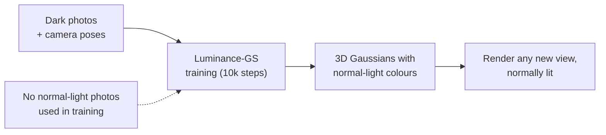

### 2.2 The dataset: LOM

The **LOM** dataset (from Aleth-NeRF) has five real scenes: **buu, chair, sofa, bike, shrub**. For each scene:

- `low/`: dark photos. These are what training sees.
- `high/`: normally lit photos of the same views. These are used **only for evaluation**, on held-out test views.
- `transforms_train.json` / `transforms_test.json`: which views are for training and which for testing, plus camera poses.
- There is also an **overexposure** subset (`over_exp`), with too-bright photos instead of dark ones.

In the repo, the training split reads `low/` and the validation split reads `high/` (`datasets/colmap.py`). Evaluation renders the *enhanced* image for each test view and compares it with the `high/` photo using PSNR, SSIM and LPIPS (`simple_trainer_ours.py:~993-1044`).

### 2.3 Your project in one paragraph

You are not inventing a new 3D representation. You are taking apart the **tone-curve machinery**, the part that decides how each dark photo is brightened, to find out what it really does. Then you replace it with something **simpler, explicit and physically motivated**: one shared curve plus one exposure number per photo. You will test whether the simpler model is as good on standard data and better when photos differ in exposure.

This is direction 1 from the meeting with Wei: a new low-light-to-normal-light transform. The "curve estimation" idea was refined by measuring the original first.

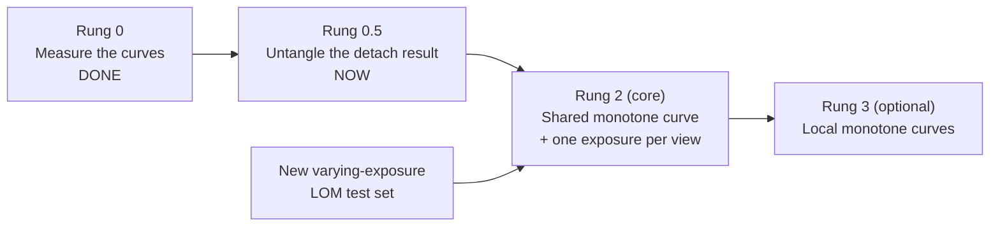

---

## 3. Background concepts

Each subsection is short. Read the ones you need.

### 3.1 Images as numbers

- An RGB image is a grid of pixels, each with three numbers (red, green, blue). Files store them as 8-bit integers 0 to 255. The code divides by 255, so values lie in **[0, 1]** (`pixels = data["image"] / 255.0`).
- A tensor of shape `[1, H, W, 3]` means: batch of 1 image, H rows, W columns, 3 channels. Training images here are 374×499 after undistortion.
- A **low-light** photo has almost all of its values near 0. In LOM, **all pixels fall in the bottom 14-25% of the value range** (Rung 0, `bin_usage.png`). The image is not black, but its information is squeezed into a few dozen of the 255 levels, with noise on top.
- Stored values are **gamma-encoded** (sRGB): they are not proportional to light. This matters in section 8.6.

### 3.2 Histograms, CDFs and histogram equalisation (HE)

- A **histogram** counts how many pixels have each value. Luminance-GS uses 255 bins over [0, 1].
- The **CDF** (cumulative distribution function) at value v is the fraction of pixels whose value is ≤ v. It starts at 0, rises, and ends at 1. It never decreases.
- **Histogram equalisation** uses the CDF itself as the tone curve: each pixel value v is replaced by CDF(v). If 90% of pixels are below 0.15, then 0.15 maps to 0.9. The result uses the whole range evenly, which brightens a dark photo a lot.

```
 Histogram of a dark photo                 Its CDF = the HE tone curve
 count                                     output
   |█                                      1.0 |        .-''''''''''''''''''
   |██                                         |      .'
   |███                                        |     /
   |████▄                                      |    /
   |█████▄▄                                0.5 |   /
   |███████▄▄▁▁                                |  /
   |██████████▄▄▁▁▁                            | /
   +------------------------- value            |/
   0    0.25   0.5   0.75   1              0.0 +------------------------- input
                                               0    0.25   0.5   0.75   1
   (all pixels crowded near 0)                 (steep where the pixels are)
```

HE alone is too aggressive. It amplifies noise and posterises: a few input levels get stretched over the whole output range. That is why Luminance-GS blends it with a smoother prior (section 6.3).

### 3.3 Tone curves, LUTs, gamma and S-curves

- A **tone curve** is a function y = L(x) from input brightness to output brightness, both in [0, 1]. Applied to every pixel, it changes brightness and contrast without moving anything.
- A **LUT** (lookup table) stores a tone curve as a list of numbers: entry *i* is the output for input level *i*. Luminance-GS's curve is a LUT with **255 entries**. Applying it means "find the entry for this pixel's value and read it out".
- **Monotone** (non-decreasing) means a brighter input never gives a darker output. A non-monotone curve can invert the order of tones, so a darker shade ends up brighter than a lighter one.
- **Gamma curve:** y = x^γ. With γ < 1 it brightens dark values strongly. With γ = 1 it does nothing.
- **S-curve:** darkens values below a midpoint α and brightens values above it, which increases contrast. β controls the strength. With α = 0.5 and β = 1, it is the identity.

Example values (computed):

| input x | identity | gamma γ=0.5 | gamma γ=0.15 | gamma γ=0.15 **with the repo's clamp at 1e-3** |
|---|---|---|---|---|
| 0.00 | 0.00 | 0.00 | 0.00 | **0.355** |
| 0.05 | 0.05 | 0.224 | 0.638 | 0.638 |
| 0.10 | 0.10 | 0.316 | 0.708 | 0.708 |
| 0.25 | 0.25 | 0.500 | 0.812 | 0.812 |
| 0.50 | 0.50 | 0.707 | 0.901 | 0.901 |
| 1.00 | 1.00 | 1.000 | 1.000 | 1.000 |

The last column is a real issue found in Rung 0. The repo clamps x to at least 0.001 before raising it to γ. With the small γ values that training learns (0.07-0.20), pure black maps to 0.25-0.62, so blacks turn grey ("lifted black level").

### 3.4 Exposure, gain and "stops"

- **Exposure** is how much light the sensor collects (shutter time × aperture × ISO). Doubling it doubles the recorded linear light. That is "+1 stop".
- A **gain** of 2^s multiplies values by 2^s. s = +1 doubles, s = −1 halves. Values above 1 are **clipped** to 1.
- For a gamma-encoded image with a power-law encoding, a gain in linear light is still a gain in the encoded values, just with a different factor: (a·z)^(1/2.2) = a^(1/2.2)·z^(1/2.2). So "multiply by 2^s" is a good model of an exposure change even on sRGB images. It is approximate because real sRGB has a small linear segment near black, and cameras add their own tone curves.

### 3.5 Colour as a 3D vector and colour bases

- A pixel's (R, G, B) is a point in 3D. You can describe the same point in a **rotated coordinate system** (another orthonormal basis n1, n2, n3), for example one axis along grey (brightness) and two axes for colour differences.
- Applying a tone curve to R, G and B separately is not the same as applying it in a rotated basis. The choice of basis changes how colours shift. The paper's **per-view colour matrix M_k** chooses a basis per photo. The repo's version is a learned rotation (section 6.3, step d).

### 3.6 Cameras and poses

- **Intrinsics K** (3×3): focal length and image centre, which say how 3D points project onto the image.
- **Extrinsics / pose**: where the camera is and which way it points. The repo stores it as a 4×4 **camtoworld** matrix (rotation + position).
- **COLMAP / SfM (Structure-from-Motion)**: estimates every photo's pose, plus a sparse cloud of 3D points, by matching features across photos. For LOM, poses and points are provided with the dataset, so training does not run COLMAP. The sparse points initialise the Gaussians.

### 3.7 NeRF vs 3D Gaussian Splatting

- **NeRF** represents a scene as a neural network queried along every camera ray. It gives good quality but is slow.
- **3DGS** represents the scene as hundreds of thousands to millions of 3D **Gaussians** (fuzzy ellipsoids). Each Gaussian has:
  - a **position** μ (3 numbers);
  - a **scale** (3, stored as log) and a **rotation** (quaternion, 4), which together give its shape Σ = R S Sᵀ Rᵀ;
  - an **opacity** o (1, stored as logit);
  - a **colour** as **spherical harmonics (SH)** coefficients (16 × 3 for degree 3), so the colour can change slightly with viewing direction.
- **Rendering (rasterisation / "splatting"):** project every Gaussian onto the image as a 2D ellipse, sort them front to back, and blend their colours with **alpha compositing**:

$$\hat C(x) = \sum_{i=1}^{N} c_i\,\alpha_i(x)\prod_{j<i}\big(1-\alpha_j(x)\big)$$

Here α_i(x) is the Gaussian's opacity times its 2D footprint at pixel x. In words, each Gaussian contributes its colour, weighted by how opaque it is and how much light is left after the Gaussians in front of it.

```
 camera ─ray─►  [G1: α=0.3, red]  [G2: α=0.5, green]  [G3: α=0.9, blue]
 pixel = 0.3·red + (1−0.3)·0.5·green + (1−0.3)(1−0.5)·0.9·blue
       = 0.30·red + 0.35·green + 0.315·blue
```

- **Training 3DGS:** render a training view, compare it with the photo (L1 + SSIM loss), backpropagate, and update every Gaussian. **Densification** periodically clones or splits Gaussians in under-reconstructed areas and prunes transparent ones. Here that happens from step 500 to step 8000, every 100 steps, with opacity resets at steps 3000 and 6000. The SH degree rises by one every 1000 steps, up to 3.

### 3.8 How training works: losses, gradients, Adam, detach

- A **loss** is a single number that says how wrong the model is. Training minimises it.
- **Backpropagation** computes the **gradient** of the loss with respect to every learnable number: which direction to nudge it, and how hard. PyTorch does this automatically.
- **Adam** is the optimiser that applies the nudges. It keeps running averages of gradients to adapt the step size. Key settings:
  - **learning rate (lr)**: step size;
  - **weight decay**: a gentle pull of parameters toward 0;
  - **schedule**: lr shrinking over training. Here it decays exponentially to 1% by step 10k.
- One **step** = one training image here (batch size 1). A run is 10,000 steps.
- **Detach / stop-gradient:** `y = f(x).detach()` uses the value of f(x) but tells backprop not to send gradient back into f or x. If a loss compares a render with a detached target, the render moves toward the target, but **the target does not move toward the render**.

```
   dark photo ──► curve ──► pseudo-target ─┐
                    ▲                       ├──► loss = |render − target|
                    │                       │
   3D Gaussians ───────────────► render ───┘
                    │
   attached: the loss also nudges the curve (target chases render)
   detached: the gradient stops at the target (only the render moves)
```

- A subtle PyTorch fact that matters for Rung 0.5: **if a parameter receives no gradient at all (`.grad` is None), Adam skips it.** It stays exactly where it was. Weight decay does not touch it either.

### 3.9 Unsupervised learning and pseudo-targets

- **Supervised:** you have the right answer (a normal-light photo) and train toward it.
- **Unsupervised / self-supervised:** you do not. You build a **pseudo-target** (a stand-in answer) from the input itself plus assumptions ("priors"), and train toward that.
- Luminance-GS's pseudo-target is the dark photo passed through the learned tone curve. Because the curve is learned at the same time, there is a chicken-and-egg loop: the curve makes the target, the target trains the Gaussians, and (if attached) the Gaussians' render pulls the curve back. This loop is what Rung 0.5 studies.

### 3.10 Neural network pieces used here

- **Convolution (conv):** slides small learned filters over the image to detect local patterns. **ReLU** zeroes out negative values. **Pooling** shrinks the image (max-pool keeps the largest value per window; adaptive average pooling resizes to a fixed grid).
- **Linear layer:** a learned matrix multiply, y = Wx + b.
- **Attention:** a *query* vector is compared with a set of *key* vectors. A **softmax** turns the similarities into weights that sum to 1, and the output is the weighted average of the matching *value* vectors.
- **Cross-attention:** the query comes from one source and the keys and values from another. In Luminance-GS, the query comes from the **camera pose** and the keys and values from the **image features**. Intuitively, the pose decides which image regions to look at.

### 3.11 Metrics

| Metric | What it measures | Better | Notes |
|---|---|---|---|
| **PSNR** (dB) | Pixel-wise error: 10·log10(1/MSE) | higher | +1 dB means the mean squared error falls by about 21%. Very sensitive to overall brightness. |
| **SSIM** | Local structure, contrast and luminance similarity | higher (max 1) | |
| **LPIPS** | Perceptual distance using deep network features | lower | Closer to human judgement. |
| **Brightness-matched PSNR** ("GT-mean") | PSNR after scaling the render so its mean equals the ground truth's mean | higher | Standard in low-light enhancement. An unsupervised method cannot know the "right" overall brightness, so this metric separates brightness from everything else. |
| **Seed std** | How much a metric changes between runs that differ only in random seed | — | Any claimed improvement must exceed this noise. |

**Detectable effect.** With 3 seeds per method, a difference counts as real if it exceeds about 2 standard errors of the difference: 2·σ·√(2/3) ≈ **1.6 × the per-run std**.

### 3.12 Experimental design words

- **Ablation:** remove or change one component and measure the effect.
- **Confound:** two things changed at once, so you cannot tell which one caused the effect.
- **Factorial (2×2) design:** test every combination of two on/off factors, so each factor's effect can be separated.
- **PCA (principal component analysis):** finds the directions along which a set of vectors varies most. "PC1 explains 99%" means the vectors differ, almost entirely, along one direction, so one number per vector describes them.

---

## 4. Glossary

| Term | Plain meaning | Where in code |
|---|---|---|
| **3DGS** | 3D Gaussian Splatting: a scene made of many coloured, semi-transparent 3D Gaussians | `gsplat/`, `simple_trainer_ours.py` |
| **Rasterisation (dual)** | Rendering Gaussians into an image. "Dual" renders two images from the same Gaussians with two colour sets | `gsplat/rendering_double.py:27` `rasterization_dual` |
| **SH (spherical harmonics)** | Coefficients that let a Gaussian's colour depend on viewing direction | `splats["sh0"]`, `splats["shN"]` |
| **Enhanced colours** | In the **repo**, the Gaussians' base SH colours. They render the bright image used at test time | `colors = cat(sh0, shN)` |
| **Low colours** | Per-Gaussian affine version of the base colours, used to reproduce the dark photo | `colors_low = colors*adjust_k + adjust_b` |
| **adjust_k, adjust_b** | Per-Gaussian, per-channel gain and offset that turn enhanced colours into low colours (paper Eq. 3, roles reversed) | `create_splats_with_optimizers` |
| **Tone curve / LUT** | 255 numbers mapping input level → output level | `self.curve`, `curve_adj` |
| **Global curve L_g** | The one learnable 255-value curve shared by all views, initialised to the identity | `self.curve` |
| **Curve bias L_b,k** | A 255-value correction per view, predicted by a network from the photo and its pose | `self.curve_adjust` (CrossAttention) |
| **View-adaptive curve L_k** | clamp(L_g + L_b,k, 0, 1): the curve actually applied to view k | `curve_adj` |
| **HE-CDF** | The cumulative histogram of the dark photo, used as a target curve | `HistogramPriorLoss.compute_histogram_equalization` |
| **Pseudo curve / shape prior P_k** | S-curve(gamma-curve(identity)) with per-view γ, α, β from a second network; a "reasonable-shape" target for the curve | `pesdo_curve`, `self.curve_adjust_gamma` |
| **Pseudo-target** | The dark photo brightened by L_k: what the bright render is trained to match | `pixels_enh` |
| **Colour basis** | Per-view rotation of RGB space before the curve is applied (the paper's M_k) | `axis1_para`, `axis2_para`, `tools.py:pixel_project` |
| **Min-max encoding** | Rescales each projected channel to [0, 1] using its possible min and max over the RGB cube | `tools.py:cal_min_max`, `value_encode` |
| **L_low** | Dark render vs dark photo (L1 + SSIM) | `loss_regress_low` |
| **L_enh** | Bright render vs pseudo-target (L1 + SSIM) | `loss_regress_enh` |
| **L_spa** | Spatial-consistency loss: the bright render's local contrast should equal the dark photo's, scaled up | `losses.py:L_spa`, `loss_co` |
| **L_hist** | Curve-level loss: curve vs HE-CDF, curve vs prior, smoothness | `losses.py:HistogramPriorLoss` |
| **Detach (pseudo-target)** | Stop the gradient from L_enh flowing into the curve and colour basis | `--detach_pseudo_target` (added on our branch) |
| **Monotone** | Never decreasing | — |
| **Anchored at black** | F(0) = 0: black stays black | Rung 2 design |
| **Lifted black level** | Black input mapped to grey output (caused by the 1e-3 clamp in the gamma prior) | `losses.py:gamma_curve` |
| **Exposure s_k** | One number per view: the view's brightness relative to the others, in stops | Rung 2 design |
| **Brightness-matched PSNR** | PSNR after scaling the render to the ground-truth mean | `diagnostics.py:psnr_gt_mean` |
| **Oracle diagnostic** | A measurement that uses ground truth the method never sees, to understand it, not to train it | Rung 0 Q6 |
| **Consistency metric** | Warp a view's image into a neighbouring view with depth and measure relative L1. Lower means more consistent across views | `diagnostics.py:_warp`, `_consistency` |
| **Rung** | One step of the research plan (0, 0.5, 2, 3) | Root `Rung*_plan.md` files |
| **H1, H2, H3** | The three hypotheses of the project | Section 8.3 |
| **Varying-exposure set** | LOM low-light with each training view given a random brightness gain | Rung 2 data, to build |
| **Luminance-GS++** | Feb 2026 follow-up: adds a clipped per-pixel residual and a colour-constancy loss. No public code found | Related work |

---

## 5. Luminance-GS as the paper describes it

This is the short version of Section 3 of the paper, so you can recognise its equations.

**Two colour sets, one geometry (Eq. 3-4).** Each Gaussian has a colour c_i (for the input lighting) and an adjusted colour c_i^out = a_i·c_i + b_i (for normal lighting). The same Gaussians render C_in with c and C_out with c^out. At test time only C_out is rendered.

**Pseudo-enhanced targets (Eq. 5-6).** For each view k:

$$C_k^{out} = L_k\big(C_k^{in}\, M_k\big)\, M_k^{-1}$$

where M_k is a learnable 3×3 colour matrix per view (start: identity) and L_k is the view's tone curve.

**View-adaptive curve.** L_k = L_g + L_b,k: a global 256-value curve plus a per-view bias predicted by a cross-attention network from the photo (keys and values) and the camera matrix (query). The paper's Fig. 2 argues that a single curve gives inconsistencies and free per-view curves overfit. The global-plus-network-bias design is its compromise.

**Losses (Eq. 7-12).**

- L_reg = L3DGS(Ĉ_in, C_in) + L3DGS(Ĉ_out, C_out), with L3DGS = λ·DSSIM + (1−λ)·L1.
- L_spa (Eq. 8), from Zero-DCE: preserve local contrast between Ĉ_out and C_in, with an adaptive factor 0.5 / mean(C_in).
- L_curve (Eq. 10) = ω·‖L − L_cdf‖² + 0.5·‖L − (L_po · L_s)‖². This is the HE-CDF target plus a gamma-and-S-curve shape prior whose parameters {G_k, A_k, B_k} come from a second network. ω = 1 for 3000 steps, then 0.1.
- L_tv (Eq. 11) = (1/255)·Σ|L(i+1) − L(i)|² for smoothness.
- **L_total = L_reg + L_spa + L_tv + 10·L_curve (Eq. 12).**

**Reported results.** On LOM low-light, the paper reports a mean of 18.34 dB PSNR, 0.799 SSIM and 0.294 LPIPS. Aleth-NeRF reaches 19.87 dB PSNR but has worse SSIM and LPIPS.

---

## 6. Luminance-GS as the repo actually implements it (in depth)

This is the part your project changes. It follows the code exactly.

### 6.1 One training step, end to end

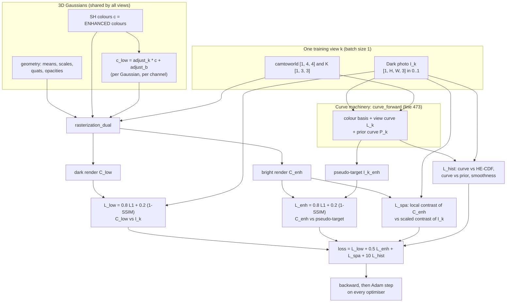

The code for this step is at `simple_trainer_ours.py:~600-660`.

**At test time** only the top half is used:

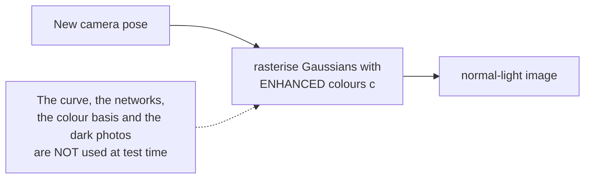

This matters. **The curve's only job is to make good training targets.** Whatever brightness and colour the pseudo-targets have gets "baked" into the Gaussians' enhanced colours.

### 6.2 The two colour sets (and a reversal from the paper)

In `rasterize_splats` (`simple_trainer_ours.py:~419`):

```python
colors     = torch.cat([self.splats["sh0"], self.splats["shN"]], 1)   # [N, 16, 3]
colors_low = colors * adjust_k + adjust_b                             # adjust_*: [N, 1, 3]
render_colors_enh, render_colors_low, ... = rasterization_dual(..., colors=colors, colors_low=colors_low, ...)
```

- The paper says the base colour c renders the *input* (dark) image and c_out = a·c + b renders the *enhanced* image.
- **The repo does the reverse.** The base SH colours render the **enhanced** image, and the affine version renders the **dark** image.
- `adjust_k` starts at 1 and `adjust_b` at 0, so at step 0 both renders are identical. They separate as L_low pulls one toward the dark photo and L_enh pulls the other toward the pseudo-target.
- Both colour sets go through the same SH evaluation, then +0.5 and clamp at ≥ 0 (`rendering_double.py:155-163`).
- Because `adjust_b` is added to every SH coefficient, not only the base one, the offset is slightly view-dependent. This is a minor quirk.

Practical consequence: **the test-time image is rendered by colours trained mainly by L_enh (pseudo-targets) and L_spa.** If the pseudo-targets are washed out or have a hue flip, so are the test renders. The bike example in section 7 shows this.

### 6.3 The curve machinery, step by step (`curve_forward`, line 473)

This function runs once per step for the current view k. Here is the whole picture first.

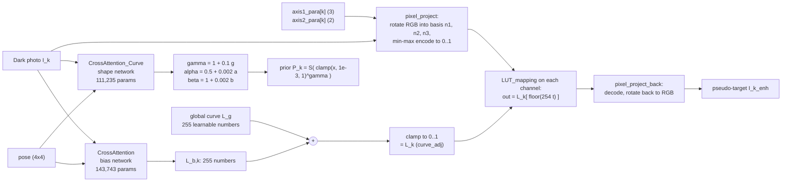

#### (a) The global curve L_g

```python
self.curve = torch.nn.Parameter(torch.linspace(0, 1, 255).unsqueeze(0))   # [1, 255], starts as identity
```

These are 255 learnable numbers, trained by Adam (lr 1e-3, weight decay 1e-4). They start as the identity line: entry i = i/254.

#### (b) The bias network L_b,k (`utils.py:CrossAttention`)

```
 dark photo [1,3,H,W]
   └─ conv 3→64 (3×3) + ReLU + maxpool 2
   └─ conv 64→128 (3×3) + ReLU
   └─ adaptive avg-pool to 4×4  →  16 image "tokens", each 128-dim  →  keys, values (Linear 128→128)
 camtoworld 4×4 → flatten 16 numbers → Linear 16→128  →  query
 attention weights = softmax(query · keysᵀ / √128)       (16 weights, sum to 1)
 context = weights · values                               (128 numbers)
 output  = Linear 128→255                                 (255 numbers = L_b,k)
```

The linear layers start with Xavier initialisation at gain 0.01, so at step 0 the bias is about 0 and L_k ≈ L_g ≈ identity. It is trained with lr 1e-5 and weight decay 1e-5.

#### (c) The view curve L_k

```python
curve_adj = torch.clamp(self.curve + curve_adj_bias, 0, 1)    # [1, 255]
```

$$L_k = \operatorname{clamp}\big(L_g + L_{b,k},\ 0,\ 1\big)$$

Nothing forces L_k to increase. The only constraint is the clamp to [0, 1].

#### (d) The colour basis (`tools.py:pixel_project`)

Each view has 5 learnable numbers that start at 0: a_k (3) = `axis1_para[k]` and b_k (2) = `axis2_para[k]`.

$$\tilde n_1 = (1,0,0) + a_k,\qquad m = (1,0) + b_k$$

$$\tilde n_2 = \Big(-\frac{m_0\,\tilde n_{1,y} + m_1\,\tilde n_{1,z}}{\tilde n_{1,x}},\ m_0,\ m_1\Big),\qquad \tilde n_3 = \tilde n_1 \times \tilde n_2$$

Then n1, n2 and n3 are the normalised versions.

- ñ2 is built so that ñ1·ñ2 = 0, and ñ3 is perpendicular to both. So {n1, n2, n3} is an **orthonormal basis**, a rotation of RGB space.
- At the start it is exactly (1,0,0), (0,1,0), (0,0,1): plain R, G, B.
- The 5 numbers give only 3 real degrees of freedom (a 3D rotation). The paper's M_k is a general 3×3 matrix with 9.

Each pixel is projected onto each axis and then **min-max encoded** into [0, 1], using the smallest and largest values that axis can take over the RGB cube:

$$t_i = \frac{n_i\cdot \mathrm{rgb} - \min_i}{\max_i - \min_i},\qquad \max_i = \sum_c \max(n_{i,c},0),\quad \min_i = \sum_c \min(n_{i,c},0)$$

At the RGB start, t = (R, G, B) exactly.

#### (e) The lookup (`tools.py:LUT_mapping`)

```python
t   = torch.clamp(t, 0, 1)
idx = (t * 254).to(torch.int32)        # truncation (floor), not rounding, no interpolation
out = lut[idx]                         # same L_k for all three channels t1, t2, t3
```

$$\text{out} = L_k\big[\lfloor 254\, t \rfloor\big]$$

Two consequences for learning:

1. **Gradient reaches the curve entries but not the pixel values.** `lut[idx]` is a copy, so the gradient of a loss with respect to entry L_k[b] is the sum of the gradients of all pixels whose index is b. The index is an integer, so **no gradient flows into t**: a curve with flat steps cannot tell the colour basis which way to move.
2. **Only used bins learn from images.** Pixels occupy only the bottom 14-25% of bins (section 7), so 75-86% of the curve gets no image gradient. Those entries are shaped only by the curve losses. That is why the *global* curve can bend down above bin 220 without anyone noticing.

#### (f) Back to RGB (`tools.py:pixel_project_back`)

Each curved channel is decoded (out·(max − min) + min), and the three are recombined along n1, n2 and n3 to give RGB again. This is the pseudo-target:

$$I_k^{enh} = \mathrm{Back}_k\Big(L_k\big[\lfloor 254\cdot \mathrm{Proj}_k(I_k)\rfloor\big]\Big)$$

The colour basis gets gradient only through this decode and recombine step, and only via `pixels_enh` (and so only via L_enh). This is the root of the Rung 0.5 confound.

#### (g) The shape prior P_k (`losses.py:gamma_curve`, `s_curve`)

A second cross-attention network (same design, 3 outputs) predicts raw (g, a, b). These are **scaled down hard**:

```python
gamma = 1.0 + 0.1   * g
alpha = 0.5 + 0.002 * a
beta  = 1.0 + 0.002 * b
pesdo_curve = s_curve(gamma_curve(linspace(0, 1, 255), gamma), alpha, beta)
```

$$P_k(x) = S_{\alpha,\beta}\big(\operatorname{clamp}(x, 10^{-3}, 1)^{\gamma}\big)$$

where the S-curve is defined in two pieces:

$$S_{\alpha,\beta}(u) = \alpha - \alpha\,(1-u/\alpha)^{\beta}\quad\text{for } u\le\alpha$$

$$S_{\alpha,\beta}(u) = \alpha + (1-\alpha)\left(\frac{u-\alpha}{1-\alpha}\right)^{\beta}\quad\text{for } u>\alpha$$

The ×0.002 scaling means α and β can barely move. Rung 0 confirmed it: α stays at 0.506-0.510 and β at 1.004-1.010, so S is about the identity. **In practice P_k is a gamma curve with one free number per view.**

#### A worked example: one pixel through the curve

The numbers are illustrative, roughly read off the buu curve in `q1_curve_shapes.png`. Basis at the RGB start.

| | R | G | B |
|---|---|---|---|
| dark pixel | 0.100 | 0.070 | 0.030 |
| index ⌊254·t⌋ | 25 | 17 | 7 |
| L_k[index] | ≈ 0.50 | ≈ 0.42 | ≈ 0.30 |
| R : B ratio | 3.3 : 1 | | → 1.7 : 1 |

The pixel is 5× brighter, but its colour ratio has halved. A single global curve that is very steep near black **compresses colour differences**, so dark saturated colours come out pale. *Inferred:* this, together with the lifted black level, is why renders look grey and washed out on bike and shrub.

*Inferred hue-flip mechanism (tested in Rung 0.5).* Once the basis rotates even slightly away from RGB, the encoded value of a dark pixel shifts. For example, an axis n2 ∝ (−0.1, 0.99, 0) has min −0.1, so a pure-green value of 0.07 encodes to about 0.15 instead of 0.07. That is a different spot on the steepest part of the curve. Small basis changes can therefore cause large colour changes after the curve.

### 6.4 Is the curve a loss? (No.) How the curve actually learns

**The curve is not a loss.** It is a *function* with learnable numbers (L_g, plus the weights of the bias network). It *produces* the pseudo-target, and *losses* decide how to change it. Two kinds of loss touch it.

1. **Curve-level losses** compare the curve itself with reference curves. These are the HE-CDF, the prior P_k, and a smoothness term.
2. **The image-level loss L_enh** compares the bright render with the pseudo-target the curve made. If the target is attached, gradient flows back into the curve.

Here is what each term "says" to curve entry b (the gradient direction, up to constants):

| Loss term | Gradient on L_k[b] | Plain meaning |
|---|---|---|
| w·mean((L_k − CDF_k)²) | ∝ w·(L_k[b] − CDF_k[b]) | "Move toward the HE curve of this photo." |
| 0.1·mean((L_k[b+1] − L_k[b])²) | ∝ neighbour differences | "Be similar to your neighbours (smooth)." |
| 0.5·mean((P_k − L_k)²) | ∝ (L_k[b] − P_k[b]) | "Move toward the gamma-shaped prior." The prior also moves toward the curve, which is how γ is learned. |
| 0.5·L_enh (attached only) | sum over pixels with index b of the per-pixel gradient | "Change so the target agrees with what the 3D scene renders." Only bins with pixels get this. |

The global curve L_g receives these gradients directly. The bias network receives them through L_b,k into its weights. The clamp passes no gradient for entries stuck at 0 or 1.

### 6.5 The losses, with exact formulas and weights

All are computed each step for the current view k (`simple_trainer_ours.py:642-658`).

**1. Reconstruct the dark photo (L_low).** This trains geometry, SH colours and adjust_k/b.

$$\mathcal{L}_{low} = 0.8\,\overline{|\hat C_{low} - I_k|} + 0.2\,\big(1-\mathrm{SSIM}(\hat C_{low}, I_k)\big)$$

**2. Match the pseudo-target (L_enh).** This trains geometry and SH colours, and, when attached, the curve, the bias network and the colour basis.

$$\mathcal{L}_{enh} = 0.8\,\overline{|\hat C_{enh} - I^{enh}_k|} + 0.2\,\big(1-\mathrm{SSIM}(\hat C_{enh}, I^{enh}_k)\big)$$

**3. Keep the structure (L_spa)** (`losses.py:L_spa`). Both images are converted to grey (channel mean) and 4×4 average-pooled (bar). Then, for each pixel and each of the four neighbours d:

$$\mathcal{L}_{spa} = \operatorname{mean}_x \sum_{d\in\{\leftarrow,\rightarrow,\uparrow,\downarrow\}} \Big(c\cdot\Delta_d \bar I_k(x) - \Delta_d \bar{\hat C}_{enh}(x)\Big)^2,\qquad c = \frac{0.5}{\operatorname{mean}(I_k)}$$

In words: if the dark photo has mean 0.1, then c = 5, and every local edge in the bright render should be 5× stronger than in the dark photo. That is exactly what brightening the image to a mean of 0.5 would do. It stops the curve from flattening detail, and it pulls overall brightness toward 0.5.

**4. Shape the curve (L_hist)** (`losses.py:47-84`). The CDF is computed from a ¼-size grey version of I_k with 255 bins.

$$\mathcal{L}_{hist} = w(t)\,\overline{(L_k - \mathrm{CDF}_k)^2} + 0.1\,\overline{(L_k[i{+}1]-L_k[i])^2} + 0.5\Big[\overline{(P_k - L_k)^2} + 0.01\,\overline{(P_k - \mathrm{CDF}_k)^2}\Big]$$

w(t) = 1 before step 3000, then 0.5 (0.1 for overexposure).

**Total:**

$$\mathcal{L} = \mathcal{L}_{low} + 0.5\,\mathcal{L}_{enh} + \mathcal{L}_{spa} + 10\,\mathcal{L}_{hist}$$

Because of the ×10, **the curve terms dominate**. On buu, the weighted CDF term is about 0.85 of a total of about 1.25 at the start. At the end, the histogram terms (0.11) are about 5× all image terms combined (0.022) (`loss_components.png`). In plain words, the curve is shaped mostly by the priors, not by what the 3D scene can render.

### 6.6 Who learns from what (gradient flow)

| Parameters | L_low | L_enh | L_spa | L_hist |
|---|---|---|---|---|
| Gaussian geometry (means, scales, quats, opacities) | ✓ | ✓ | ✓ | — |
| SH colours c (= enhanced colours) | ✓ (through c_low) | ✓ | ✓ | — |
| adjust_k, adjust_b | ✓ | — | — | — |
| Global curve L_g | — | ✓ attached only | — | ✓ |
| Bias network (CrossAttention) | — | ✓ attached only | — | ✓ |
| Shape network (γ, α, β) | — | — | — | ✓ (prior terms) |
| **Colour basis (axis1, axis2)** | — | **✓ attached only: its only source** | — | — |

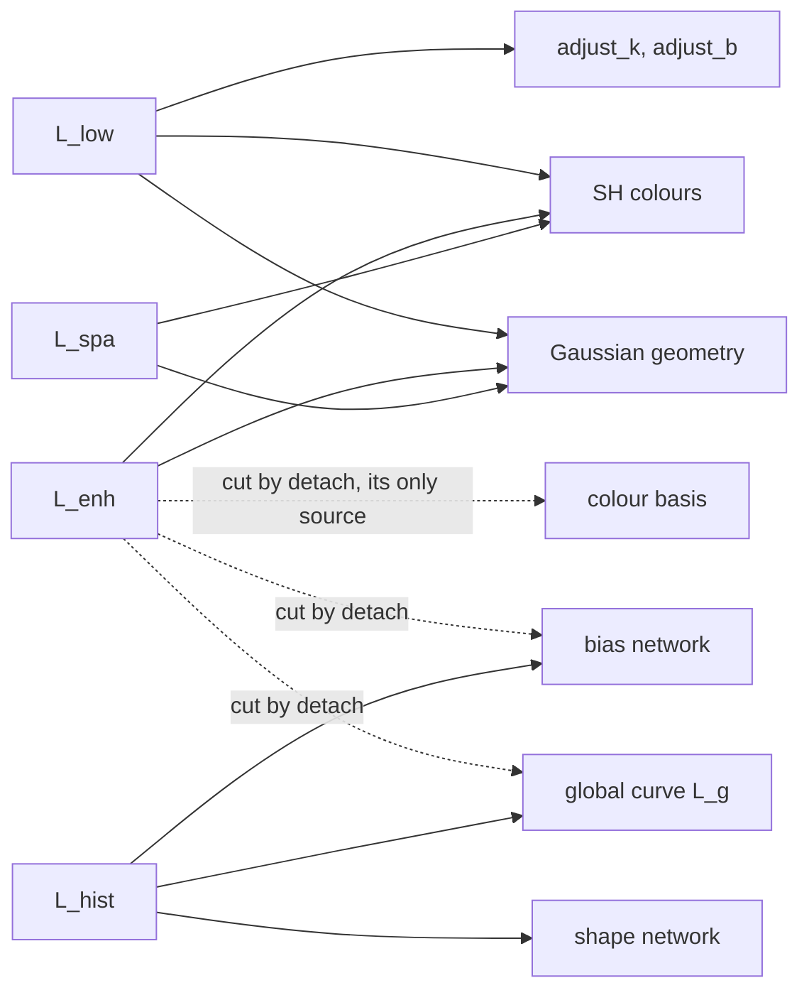

This table explains the **Rung 0.5 confound**. `--detach_pseudo_target` stops L_enh from training the curve, which was intended. It also leaves the colour basis with no gradient at all, so Adam never updates it and it stays at plain RGB, which was not intended. The +2 dB "detach gain" could come from either effect.

### 6.7 Optimisers and schedule

| Group | Parameters | Optimiser | lr | weight decay | lr decays to 1%? |
|---|---|---|---|---|---|
| Gaussians | means 1.6e-4×scene_scale, scales 5e-3, quats 1e-3, opacities 5e-2, sh0 2.5e-3, shN 2.5e-3/20, adjust_k/b 2.5e-3 | Adam (one per parameter) | as listed | 0 | means only |
| Curve | global curve L_g | Adam | 1e-3 | 1e-4 | yes |
| Networks | bias net + shape net | Adam | 1e-5 | 1e-5 | yes |
| Colour basis | axis1, axis2 (all views) | Adam | 2e-4 | 1e-4 | yes |

Training timeline (10k steps):

```
step:   0     500    1000   2000   3000          6000          8000   9000   10000
        |------|------|------|------|-------------|-------------|------|-------|
SH deg  0      .      1      2      3 ..............................................
densify        [============ clone / split / prune every 100 steps ====]
opacity reset                       ^ 3000        ^ 6000   (only while densifying, so none at 9000)
CDF weight w   1 ...................| 0.5 (0.1 for over_exp) ...........................
gamma (Rung 0)  falls from 1 to ~0.1 between ~1000 and ~3000, then flat
```

### 6.8 Paper vs repo: the differences that matter

| # | Aspect | Paper | Repo |
|---|---|---|---|
| 1 | Colour roles | base c renders dark, c_out = a·c + b renders bright | **reversed:** base SH colours render bright, k·c + b renders dark |
| 2 | Colour matrix | free invertible 3×3 M_k (9 numbers) | 5-number orthonormal basis (3 real degrees of freedom) with min-max encoding |
| 3 | Curve length | 256 | 255 |
| 4 | Lookup | not specified | truncation ⌊254t⌋, no interpolation, no gradient to pixel values |
| 5 | Monotonicity | not enforced | not enforced (clamp to [0, 1] only) |
| 6 | Curve per channel | L_k applied to the mapped image | one curve for all three projected channels |
| 7 | Shape prior | L_po · L_s with learnable G, A, B; ε = 1e-4 added | composition S(γ-curve); γ = 1 + 0.1g, α = 0.5 + 0.002a, β = 1 + 0.002b; input clamped at 1e-3 (the black-level lift) |
| 8 | CDF weight after 3000 steps | 0.1 | **0.5** for low-light (0.1 only for overexposure) |
| 9 | Smoothness | separate L_tv, (1/255)·Σ squared differences | inside L_hist: 0.1·mean of squared differences, then ×10 |
| 10 | Extra term | — | 0.01·MSE(P_k, CDF_k) |
| 11 | CDF source | input image | ¼-size grey (channel mean) image, 255 bins |
| 12 | Regression weights | L_in + L_out equally | L_low + **0.5**·L_enh |
| 13 | Pseudo-target gradient | not discussed | not detached by default. `--detach_pseudo_target` was added on our branch |
| 14 | Seed | — | hard-coded 42 originally. `--seed` was added on our branch |

---

## 7. What Rung 0 found

Rung 0 measured the original, without changing it. It ran 30 runs: 5 scenes × {baseline, detach} × seeds 0-2. The full write-up is in [`Rung0_results.md`](Rung0_results.md), and the tables and figures are in [`Luminance-GS/results/rung0/summary/`](Luminance-GS/results/rung0/summary/).

| Question | Finding | What it means for you |
|---|---|---|
| Are the curves non-monotone? | Almost never. Only shrub baseline has a few decreasing steps (≤ 5/255). | Monotonicity alone will not change results. Its value is compactness and anchoring. |
| How much do curves differ across views? | Very little. Cross-view RMS is 1.4-4.9/255, and **PC1 explains 99.2-99.8%** of the variation, with \|r\| = 0.97-1.00 against the view's brightness. | One number per view is enough. **This is the evidence for "exposure".** |
| What does the bias network do? | Its output is large (RMS 51-70/255) but almost identical across views (std 1.4-4.9/255). | It is effectively a second global curve. Its 144k parameters buy about one number per view. |
| How compact can a curve be? | A monotone piecewise-linear fit with **K = 32** knots over the used range reproduces it to **0.70/255**. Uniform knots need more than 64 segments. | Use K = 32 with knots dense near black. |
| Does the shape prior adapt? | γ falls to 0.07-0.20. α and β never move. | The prior is a one-number gamma curve. |
| Black level? | Black input maps to 0.30-0.64 in the prior (1e-3 clamp). Learned curves follow part way. | Anchor F(0) = 0. *Inferred* cause of the washed-out look. |
| Which bins are used? | Only 14-25% of bins. | Most of the curve gets no image gradient. |
| Which losses dominate? | Histogram terms are about 5× the image terms at the end. | The priors, not the images, shape the curve. |
| Does detach help? | Brightness-matched PSNR: chair +2.16, sofa +2.16, bike +1.86 dB (5-19× noise). Bike LPIPS −0.118. About 40% faster. | Big, but **confounded** with the frozen colour basis, so Rung 0.5 is needed. |
| Seed noise | Raw PSNR std: buu 0.21, chair 0.37, sofa 0.58, bike 0.45, shrub 1.13 dB | Sets the detectable effects (section 8.9). |
| Pseudo-target quality (oracle) | 12.1-25.2 dB raw, 17.8-26.8 dB brightness-matched against the training-view ground truth. The render beats its own targets by 0.1-0.9 dB. | Multi-view fusion averages out per-view errors. |
| Cross-view consistency | Baseline pseudo-targets are 0.69-1.30× as inconsistent as real photos. Detached ones are 1.0-2.0×. | Targets are already about as consistent as real photos, so local adaptivity (Rung 3) is optional. |

**What the curves look like** (baseline, step 10k; shading = bins that pixels use):

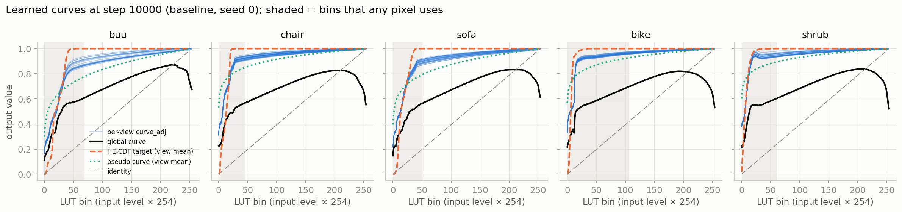

- Per-view curves (blue) are bunched together and far above the global curve (black). The bias network adds the same large offset everywhere.
- The HE-CDF target (orange) shoots to 1.0 within the first 30-60 bins.
- The prior (green dotted) starts at 0.3-0.6 at black, which is the lifted black level.

**Which bins pixels use** (log scale, nothing above bin ≈ 95):

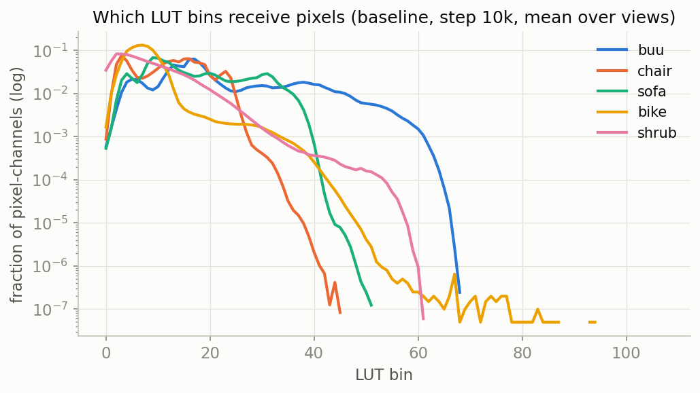

**The bike hue flip.** Columns: dark input | pseudo-target | render | ground truth.

Baseline: the left wheel turns red, the right stays yellow, and the target is posterised.

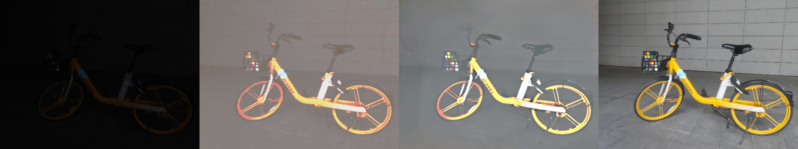

Detached (colour basis frozen at RGB as a side effect): both wheels stay yellow.

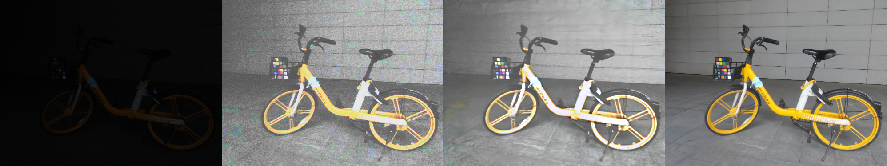

---

## 8. Your research direction

### 8.1 The problem in one sentence

Luminance-GS spends about 255k parameters and two neural networks on a per-view tone curve. That curve really varies across views along **one** brightness-like direction, is dominated by hand-set priors, and lifts the black level. Its colour basis may cause hue flips. It also has no explicit way to handle photos taken at **different exposures**, which is the normal situation for real captures.

### 8.2 Research question

> Does Luminance-GS's view-adaptive curve machinery reduce to **a shared tone curve plus one exposure value per view**? And does modelling it that way explicitly (a shared monotone curve anchored at black, one exposure per view, a fixed colour basis) **match or beat the original with far fewer parameters**, especially when exposure varies across views?

### 8.3 Hypotheses

| | Hypothesis | Tested by |
|---|---|---|
| **H1** | On LOM low-light and overexposure, Rung 2 **matches** the baseline within the detectable effect, while removing the bias network and the shape-prior network. | Rung 2 vs baseline, 5 scenes × 3 seeds |
| **H2** | On scenes with per-view exposure variation, Rung 2 **beats** the baseline, and the learned exposures s_k **correlate with the true ones**. | The new varying-exposure LOM set |
| **H3** | A **fixed colour basis removes the hue flips** and accounts for most of the detach gain. | Rung 0.5 (2×2), colour metrics |

### 8.4 The rung ladder

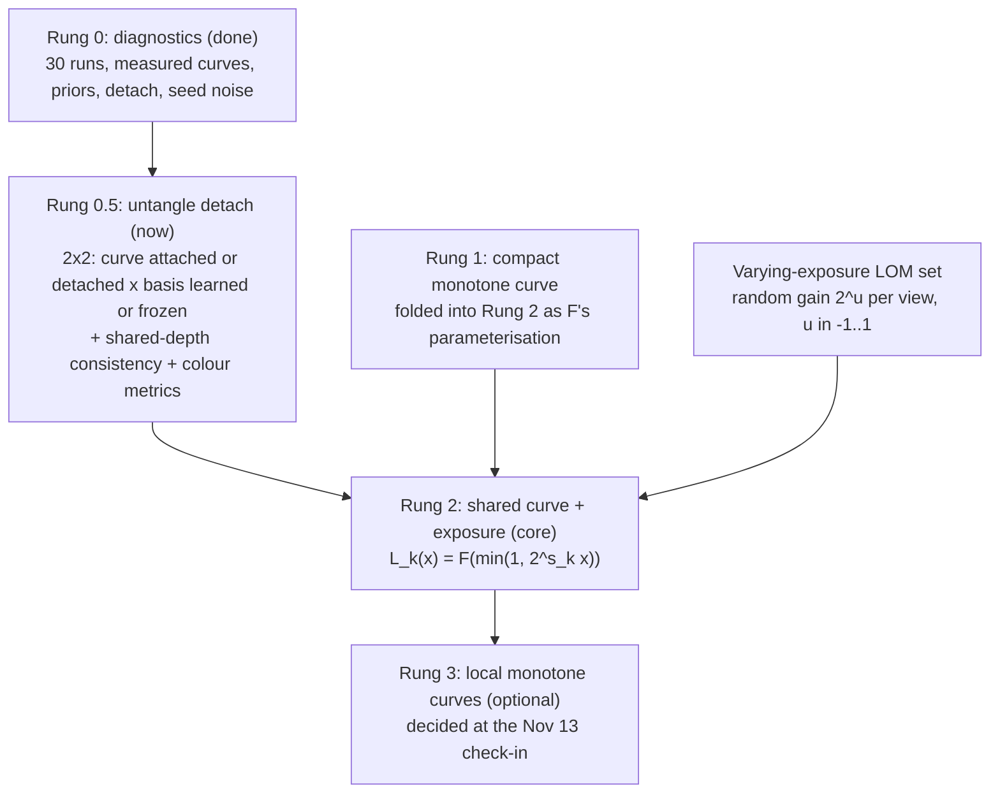

### 8.5 Rung 0.5: the 2×2 that untangles detach

| | Colour basis learned | Colour basis frozen at RGB |
|---|---|---|
| **Curve trained by L_enh (attached)** | `baseline` (exists) | **`frozenbasis`** (new flag `--freeze_color_basis`) |
| **Curve not trained by L_enh** | **`detachcurve`** (new flag `--detach_curve_in_target`) | `detach` (exists) |

- **Main effect of the basis** = average of (frozen − learned) over both rows. **Main effect of curve detaching** = average of (detached − attached) over both columns. If the basis explains most of the gain, H3 is supported.
- It also re-scores every run with **one shared reference depth per scene**. Rung 0's consistency metric used each run's own depth, so its ground-truth level moved between variants. It also adds **brightness-invariant colour metrics** (angular error, hue error on saturated pixels, saturation ratio), so hue flips are measured instead of eyeballed.
- **Outcome → Rung 2 design:** whether Rung 2 keeps a per-view colour basis or uses plain RGB, and whether its curve is trained attached or detached by default.
- The full instructions for Claude Code are in [`Rung0.5_diagnostics_plan.md`](Rung0.5_diagnostics_plan.md).

### 8.6 Rung 2 in depth: one shared curve plus one exposure per view

#### The model

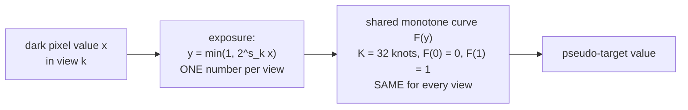

$$L_k(x) = F\big(\min(1,\ 2^{s_k}\,x)\big)$$

- **s_k** is a free scalar per view, in stops. It is learned directly with no network. A view that is darker than the others gets a larger s_k.
- **F** is a monotone piecewise-linear curve with K = 32 segments, shared by all views. It replaces both L_g and the bias network.
- The colour basis is fixed to RGB, or kept, depending on Rung 0.5. F is applied to R, G and B as now.

#### Why this form (three reasons)

1. **Data:** Rung 0 found that the per-view curves differ along one direction (PC1 99%+), which tracks brightness at \|r\| ≥ 0.97. A per-view gain before a shared curve is exactly a one-parameter family of curves ordered by brightness.
2. **Physics:** a camera records I_k = f(e_k·E), where E is scene light, e_k the view's exposure and f the camera response. A consistent enhancement is a fixed function of the scene light: target = g(E) = g(f⁻¹(I_k)/e_k). If f is a power law f(z) = z^(1/γ), this becomes

$$\text{target} = g\big((e_k^{-1/\gamma}\, I_k)^{\gamma}\big) = G\big(2^{s_k} I_k\big),\qquad G(y) = g(y^{\gamma}),\quad 2^{s_k} = e_k^{-1/\gamma}$$

So "gain per view, then one shared curve" is the *exact* form for a power-law camera, and a close approximation for real sRGB.
3. **Economy:** about 255k parameters become about 32 + N. Every remaining number is interpretable: F is the scene's tone mapping, and s_k is the view's relative exposure, which you can check against the truth.

#### The curve F: monotone, anchored, compact

Choose knots y_0 = 0 < y_1 < … < y_K = 1, **dense near black**. A simple default is quadratic spacing, y_j = (j/K)², which puts half the knots in [0, 0.25], where all the pixels are. The knot heights come from unconstrained parameters θ_1..θ_K:

$$F_j = \frac{\sum_{i=1}^{j}\operatorname{softplus}(\theta_i)}{\sum_{i=1}^{K}\operatorname{softplus}(\theta_i)},\qquad F_0 = 0,\ F_K = 1$$

softplus(θ) = log(1 + e^θ) > 0, so each step up is positive. That makes F **strictly increasing by construction**, with F(0) = 0 (black stays black) and F(1) = 1. Between knots, **linearly interpolate**:

$$F(y) = F_{j-1} + (F_j - F_{j-1})\,\frac{y - y_{j-1}}{y_j - y_{j-1}},\qquad y\in[y_{j-1},y_j]$$

Interpolation fixes the LUT's truncation. F has a slope, so **gradient now flows to the pixel value y and therefore to s_k**:

$$\frac{\partial F(2^{s_k}x)}{\partial s_k} = F'(y)\cdot y\,\ln 2,\qquad y = 2^{s_k}x < 1$$

Initialise θ so that F starts close to the average HE-CDF, or the identity. That is a design choice to test.

#### The exposures s_k

- **Initialisation:** s_k = log2(m̄ / m_k), where m_k is view k's mean brightness and m̄ the geometric mean over views. Darker views start with larger gains.
- **Gauge fix:** F and s are interchangeable. Adding c to every s_k and replacing F(y) with F(2^(−c)y) gives the same outputs, apart from clipping. So pin **mean_k s_k = 0** (subtract the mean after each step). Then s_k is *relative* exposure and F carries the overall brightening.

#### The losses in Rung 2

- Keep L_low, L_enh and L_spa unchanged.
- Replace L_hist with a curve loss on the composed per-view curve, evaluated on the same 255-bin grid x_b = b/254:

$$\mathcal{L}_{curve} = \frac{1}{255}\sum_{b}\Big(F\big(\min(1,2^{s_k}x_b)\big) - \mathrm{CDF}_k[b]\Big)^2 + \lambda\,\mathcal{R}_{smooth}(F)$$

  R_smooth is, for example, squared differences of neighbouring slopes. Optionally weight the bins by how many pixels use them.
- **Drop** the bias network and the gamma/S-curve shape network. An optional ablation keeps a single global gamma prior (1 parameter, no 1e-3 clamp) as a regulariser.
- Because F is shared, the CDF term now acts like **histogram matching across views**. Each view's s_k is pushed to line its histogram up with the shared curve.

#### Side by side

| Component | Baseline (repo) | Rung 2 |
|---|---|---|
| Shared curve | L_g: 255 free values, not monotone | F: K = 32, monotone, F(0) = 0 |
| Per-view curve change | bias network, **143,743** params → 255 values per view | **1 number per view** (s_k) |
| Shape prior | shape network, **111,235** params → γ, α, β per view | removed (optional 1 global γ) |
| Colour basis | 5 numbers per view | fixed RGB, or kept (Rung 0.5 decides) |
| Lookup | truncated LUT, no gradient to pixel values | interpolated, gradient flows to s_k |
| **Total curve parameters** | **≈ 255,000 + 5N** | **≈ 32 + N** (+5N if the basis is kept) |
| Test-time rendering | unchanged (curve not used) | unchanged (curve not used) |

**Overexposure** uses the same form. s_k is then a darkening gain, and F maps bright values down. Only the CDF weight changes, as in the original.

### 8.7 The varying-exposure test set (needed for H2)

LOM's dark views are **evenly lit**: all views in a scene have similar brightness. On LOM alone, a per-view exposure model has nothing to do, so Rung 2 can at best tie (H1). To show its advantage, you need views with different exposures and a known truth.

**Recipe (cheap, controlled):** for each LOM low-light scene and each training view k:

1. Draw u_k uniformly from [−1, 1], so the gain 2^(u_k) is between ½× and 2×.
2. Make I'_k = clip(2^(u_k)·I_k, 0, 1) and re-quantise to 8 bits.
3. Keep the test views and the `high/` ground truth **unchanged**.

Run the baseline and Rung 2 on it. Since the input was scaled by 2^(u_k), the ideal learned exposure is **s_k ≈ −u_k + constant**. So the key plot is learned s_k against true u_k: slope ≈ −1, correlation close to −1. For the baseline you can plot its PC1 score against u_k for comparison. Optional second test: the paper's varying-exposure Mip-NeRF 360 set, if available (slower and less controlled).

### 8.8 Rung 3 (optional stretch): local monotone curves

A global curve maps equal input values to equal outputs everywhere in the image, which limits colour and local-contrast fixes. Rung 3 would mix M = 4-8 shared monotone curves with per-pixel weights from a small conv net:

$$L_k(x,p) = \sum_{m=1}^{M} w_{k,m}(p)\,F_m(x),\qquad w_{k,m}(p)\ge 0,\ \ \sum_m w_{k,m}(p)=1$$

A convex mix of increasing curves is still increasing, so tone order is preserved at every pixel. An additive residual like Luminance-GS++'s cannot guarantee that. Rung 0 showed the pseudo-targets are already as consistent as real photos, so Rung 3 goes ahead only if Rung 2's full runs are done by the mid-November check-in.

### 8.9 What you will have to do

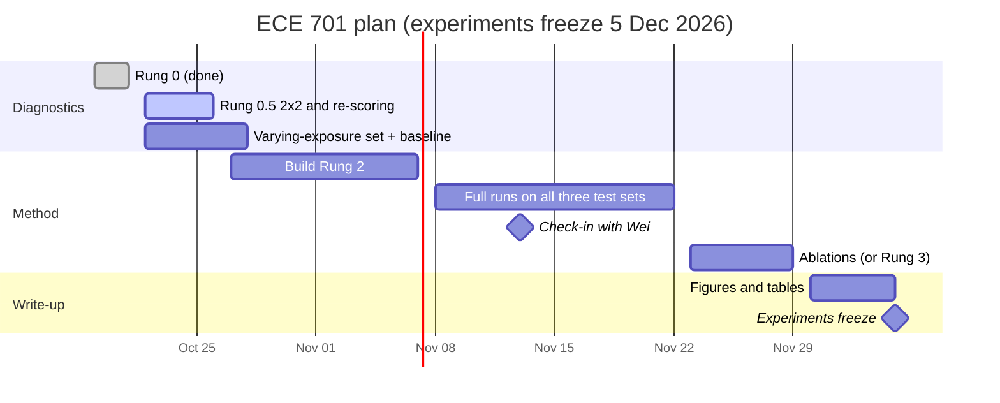

Checklist:

1. **Rung 0.5:** give `Rung0.5_diagnostics_plan.md` to Claude Code and run it. Read `Rung0.5_results.md`. Decide the colour basis and the default mode for Rung 2.
2. **Varying-exposure set:** write the gain script, record each view's u_k, and run the baseline on it (5 scenes × 3 seeds). These are the numbers Rung 2 must beat.
3. **Build Rung 2 behind flags** (defaults reproduce the original): the monotone F module (with a unit test that F is increasing, F(0) = 0 and gradients reach s_k), per-view s_k with the gauge fix, the new curve loss, and the removal of the two networks. Run a smoke test on one scene.
4. **Full runs:** LOM low-light, LOM overexposure and the varying-exposure set, 3 seeds each, in the chosen mode, plus the other mode on low-light.
5. **Check-in with Wei (Nov 13):** show the main tables. Decide on Rung 3 or extra ablations.
6. **Ablations:** K (16/32/64), knot spacing (uniform/quadratic), basis on/off, attached/detached, gamma prior on/off.
7. **Figures and write-up.**

Compute budget: one run takes about 7-12 minutes (detached runs are about 40% faster), so one configuration on 5 scenes × 3 seeds takes about 2-3 hours.

### 8.10 What you will show

1. **Main table:** raw PSNR, brightness-matched PSNR, SSIM and LPIPS, as mean ± std over 3 seeds, per scene. Baseline vs Rung 2, on LOM low-light and overexposure.
2. **Varying-exposure table:** the same metrics on the new set.
3. **Exposure scatter:** learned s_k vs true u_k per scene, with the correlation and slope, next to the baseline's PC1 score vs u_k.
4. **Curve figure:** Rung 2's F (and F(2^(s_k)x) per view) against the baseline's per-view curves and the HE-CDF.
5. **Efficiency table:** curve parameters (≈ 255k vs ≈ 32 + N), wall time per run.
6. **Qualitative:** side-by-side novel views with zoomed crops on the known failure cases (bike wheels, shrub leaves), plus pseudo-targets of neighbouring views.
7. **Consistency and colour metrics** from Rung 0.5's shared-depth re-scoring.
8. **Ablations** (section 8.9, step 6).
9. **Motivation figures** from Rungs 0 and 0.5: PC1, bin usage, loss balance, the 2×2.

### 8.11 How you will know it worked

Detectable effects come from Rung 0 (3 seeds per arm, 1.6 × per-run std).

| | Raw PSNR | Brightness-matched PSNR |
|---|---|---|
| buu | 0.3 dB | ≈ 0.2-0.7 dB |
| chair | 0.6 dB | ≈ 0.2-0.7 dB |
| sofa | 0.9 dB | ≈ 0.2-0.7 dB |
| bike | 0.7 dB | ≈ 0.2-0.7 dB |
| shrub | 1.8 dB | ≈ 1.6 dB |

| Hypothesis | Supported if | If it fails, you learn |
|---|---|---|
| **H1** | On every LOM scene, Rung 2's brightness-matched PSNR is within the detectable effect of the baseline or better, with SSIM and LPIPS no worse beyond seed noise, using ≈ 255k fewer curve parameters. | The per-view networks carry more than exposure. The residual after removing PC1 shows what, and a low-rank per-view correction is the fallback. |
| **H2** | On the varying-exposure set, Rung 2 beats the baseline by more than the detectable effect in most scenes (proposed: ≥ 4 of 5). Learned s_k track true u_k (proposed: \|r\| ≥ 0.9, slope near −1). | Exposure is not identifiable from these losses: the curve and exposures trade off. The gauge fix, initialisation and loss weights are the suspects. |
| **H3** | In Rung 0.5, freezing the basis alone recovers most of the detach gain on chair, sofa and bike. Hue error falls and the bike wheels stay yellow. | The "target chasing the render" effect is the main cause. Rung 2 then defaults to a detached curve, and the basis question becomes secondary. |

A negative result on H1 or H3 is still a clean, reportable finding about a CVPR 2025 method, because the diagnostics explain *why*.

---

## 9. Questions Wei / Dr Chen will most likely ask

**Q1. What is your contribution in one sentence?**
I show that Luminance-GS's per-view curve machinery is effectively one shared curve plus one exposure per view, and I replace it with that explicit model. The new model is monotone, anchored at black and about 32 + N parameters instead of about 255k. I test whether it matches the original on LOM and beats it when exposure varies across views.

**Q2. Why not just enhance each photo with a 2D method and train normal 3DGS?**
Per-image enhancers brighten each view slightly differently, and 3DGS turns those inconsistencies into floaters and colour flicker. The paper's Table 1 shows "enhancer + 3DGS" combinations scoring below Luminance-GS. Joint training keeps the brightening consistent across views.

**Q3. ChatGPT's original idea was to make the curve monotonic. Is that still the idea?**
Only partly. Rung 0 showed the learned curves are already monotone except shrub baseline (≤ 5/255), so monotonicity alone would change little. What matters is the structure: a compact curve shared by all views, anchored at black, plus an exposure per view.

**Q4. Why one exposure number per view and not a free curve per view?**
- Data: in Rung 0, PC1 explains 99.2-99.8% of the cross-view curve variation, and it tracks brightness (|r| = 0.97-1.00).
- Physics: for a power-law camera, "gain then shared curve" is exactly the consistent enhancement.
- Practice: it is far fewer parameters, and the parameter is interpretable and checkable.

**Q5. Isn't this just a simplification? Where is the novelty?**
There are three parts:

1. An analysis showing what a published method's curve machinery actually learns, including the confounds.
2. An explicit, physically grounded exposure-plus-curve model for unsupervised low-light 3DGS. It is a camera-response-style model, which Luminance-GS lacks.
3. A test under varying exposure, where the explicit model should win and its learned exposures can be checked against the truth.

Showing that a simpler model is as good, and better where it should be, is a standard and valued result.

**Q6. How does this relate to Luminance-GS++ and other recent work?**
- Luminance-GS++ (Feb 2026) adds a clipped per-pixel residual and a colour-constancy loss, and reports 18.34 → 20.74 dB on LOM low-light. It builds on the same curve machinery, has no monotonicity constraint, and has no public code. It is complementary: our curve could replace theirs.
- Lyu et al. (Jun 2026) report that the gain from nonlinear tone curves for pseudo ground truth is "curve-agnostic". That fits our finding that the priors dominate and the curve's fine shape matters less than its structure.
- Naka-GS and NOVA-GS work on poses (direction 2), which is orthogonal.

**Q7. Why does detaching the pseudo-target help, and is your comparison fair?**
In the repo, detaching also cuts the only gradient to the per-view colour basis, so it stays at RGB. The +2 dB therefore mixes two effects. Rung 0.5's 2×2 design separates them, and every comparison is reported in both modes.

**Q8. How do you know improvements aren't noise?**
Three seeds per configuration, paired comparisons, and per-scene detectable effects measured in Rung 0. Raw PSNR seed std ranges from 0.21 dB (buu) to 1.13 dB (shrub). A difference counts only if it exceeds about 1.6 × the per-run std.

**Q9. Why report brightness-matched PSNR?**
An unsupervised method cannot know the "correct" overall brightness. Here it is set by the histogram prior, at about 0.55-0.6 for every scene, while the ground truth ranges from 0.36 to 0.54. Raw PSNR mostly measures that global offset. Brightness-matched (GT-mean) PSNR is standard in low-light enhancement. Both are reported.

**Q10. The varying-exposure set is synthetic. Is that a fair test?**
It is controlled: the true per-view gains are known, so we can check the learned exposures directly, and the ground truth is untouched. Multiplying sRGB values approximates a real exposure change (exact for a power-law encoding). The paper's own varying-exposure benchmark is also synthetic (Mip-NeRF 360 with simulated exposures), and it is an optional second test.

**Q11. Can the curve and the exposures trade off against each other (identifiability)?**
Yes: shifting all s_k by c and re-scaling F's input gives the same result. Fixing the mean of s_k to 0 removes this. s_k is then relative exposure, and F carries the absolute brightening.

**Q12. Does the curve get used at test time? Can you control brightness at render time?**
No. Test views are rendered from the Gaussians' enhanced colours only. The curve exists to make good training targets. Brightness control at render time would need a separate change.

**Q13. Why are the results washed out (bike, shrub), and does your model fix it?**
*Inferred:* two causes.
- The gamma prior clamps its input at 1e-3, so with γ ≈ 0.1 black maps to 0.3-0.6 (a lifted black level).
- A single steep curve compresses dark colour ratios.

F(0) = 0 fixes the first cause by construction. The second is a limit of any global curve, which is Rung 3's territory.

**Q14. What about the colour matrix M_k from the paper?**
The repo implements it as a 5-number rotation (3 real degrees of freedom), not a free 3×3 matrix. The paper's own ablation credits it with +0.04 dB on buu. The bike hue flip suggests it can hurt. Rung 0.5 measures it directly and decides whether Rung 2 keeps it.

**Q15. How does this handle overexposure?**
With the same form. s_k becomes a darkening gain, and F maps bright values down. Only the CDF weight changes, as in the original. It is tested on the LOM overexposure subset.

**Q16. What if Rung 2 is worse?**
Then the per-view network carries something beyond exposure. The residual curve variation after PC1 (0.2-0.8% of the variance) shows what. A small low-rank per-view correction is the fallback. Either way, the analysis is a result.

**Q17. Is it feasible by early December on one GPU?**
Yes. A run takes about 7-12 minutes, and one configuration (5 scenes × 3 seeds) about 2-3 hours. Rung 2 changes only the curve module and its losses; rendering and Gaussians are untouched. Rung 3 is optional and is decided at the Nov 13 check-in.

**Q18. What about noise in dark images?**
The curve amplifies noise in each pseudo-target, but multi-view fusion averages it out: renders beat their own pseudo-targets by 0.1-0.9 dB brightness-matched (Rung 0). Denoising is not the focus of this project.

**Q19. How were the paper-vs-repo differences found, and do they affect the comparison?**
By reading the code (section 6.8). All experiments run the repo's code, with new behaviour behind flags whose defaults reproduce the original, so the baseline is the authors' actual implementation.

---

## 10. TL;DR of everything

- **What Luminance-GS does:** builds a normally lit 3D Gaussian scene from dark photos, with no normal-light supervision. It brightens each photo with a learned tone curve into a pseudo-target and trains the Gaussians to render both the dark photo and the pseudo-target. Only the bright render is used at test time.
- **How the curve is computed (repo):**
  - L_k = clamp(L_g + bias network(photo, pose)), a 255-entry LUT.
  - It is applied to each channel in a learned per-view rotated colour basis, by truncated lookup.
  - It is trained mostly by 10·L_hist, which pulls it toward the photo's HE-CDF, toward a gamma prior and toward smoothness. When attached, L_enh also trains it.
  - The total loss is L_low + 0.5·L_enh + L_spa + 10·L_hist.
- **Is the curve a loss?** No. It is a learnable function that makes the targets. The losses train it.
- **Rung 0 found:**
  - The curves are monotone, and the per-view variation is one number that tracks brightness.
  - The S-curve prior never moves, the black level is lifted, and the priors outweigh the image terms 5:1.
  - Detach helps by up to 2.2 dB, but that result is confounded with the frozen colour basis.
- **Rung 0.5 (now):** a 2×2 experiment (curve attached/detached × basis learned/frozen), with shared-depth consistency and colour metrics. It decides the colour basis and the default mode for Rung 2.
- **Rung 2 (core):** L_k(x) = F(min(1, 2^(s_k)·x)). F is shared, monotone, anchored at black and has K = 32 knots dense near black, with interpolation. s_k is one exposure per view, with mean 0. Parameters drop from about 255k to about 32 + N, and the model is physically grounded.
- **Hypotheses:**
  - H1: matches on LOM.
  - H2: wins on a varying-exposure LOM set, with s_k tracking the true gains.
  - H3: the fixed colour basis removes the hue flips.
- **Proof:** 5 scenes × 3 seeds, brightness-matched and raw PSNR, SSIM, LPIPS, consistency and colour metrics, an exposure scatter plot, a parameter count, and ablations. Differences count only beyond the detectable effects from Rung 0.
- **Timeline:**
  - Rung 0.5 and the varying-exposure set: by Oct 28.
  - Rung 2 build: by Nov 7.
  - Full runs: Nov 8-22 (check-in with Wei on Nov 13).
  - Ablations: Nov 23-29.
  - Figures: to Dec 5, when experiments freeze.
